  

<h1 align="center">¡Hola, soy Derlis Caiza! 👋</h1>

  

---

## 🧑‍💻 Sobre mí

- 🎓 Estudio **Sistemas de la Información** en la **Universidad Central del Ecuador (UCE)**
- 📚 Estoy cursando el **cuarto semestre** de la carrera
- 📍 Vivo en **Quito, Ecuador**
- 🌱 Estoy aprendiendo **Git y GitHub** en la materia de Algoritmos
- 🎯 Mi meta: conocer más a fondo la carrera y **especializarme en programación web**

## 🛠️ Herramientas que conozco

> Conozco las bases de cada una y sigo aprendiendo.

## ⚽ Hobbies

- ⚽ Jugar **fútbol**
- 🏋️ Ir al **gym** y practicar cualquier otro deporte
- 🎮 Videojuegos **retro de PS2**, como *Resident Evil 4* y *Need for Speed*

## 📫 Contacto

- GitHub: [@goderlis11](https://github.com/goderlis11)

---

⭐ Gracias por visitar mi perfil ⭐

